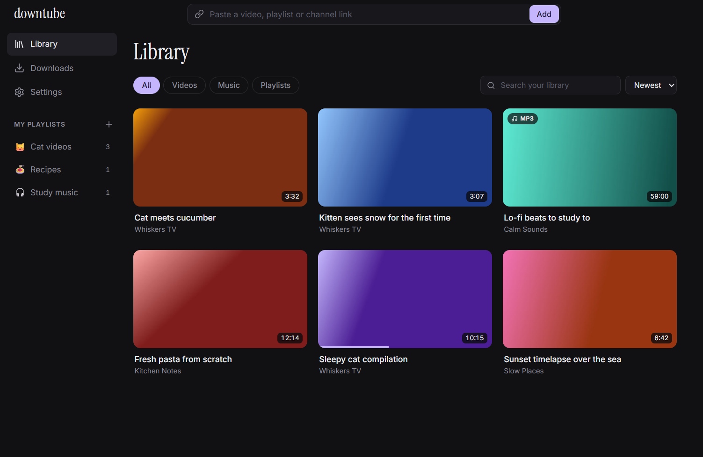

<p align="center"></p>

<h1 align="center">downtube</h1>

<p align="center">Download YouTube videos, music, playlists and channels, and Spotify songs, albums and playlists, and play them offline.</p>



## Features

- **Videos** as MP4 in Best, 1080p, 720p or 480p.
- **Music** as MP3 with cover art and tags.
- **Playlists and channels** are listed first, so you pick what to download.
- **Spotify links**: paste a song, album or playlist link and Downtube finds each song on YouTube Music, downloads it as MP3 and tags it with Spotify's title, artist, album and cover. No Spotify account needed.
- **Size before you download**, next to your free disk space, with a warning when it will not fit.
- **Your own playlists**: drag videos and songs onto them in the sidebar, reorder them, give them an emoji and play them back to back.
- **Offline player** with subtitles, speed control, picture-in-picture and keyboard shortcuts.
- **Chapters** from YouTube: marked on the seek bar, listed in the player so you can jump to one, and saved inside the file so other players see them too.
- **Music bar** that keeps playing across pages, with a queue, shuffle, repeat and media keys.
- **Resume** videos and songs where you left off.
- **Clipboard detection**: copy a YouTube or Spotify link and Downtube offers to download it.
- Dark and light themes.
- **13 languages**: English, Turkish, German, Spanish, French, Portuguese (Brazil), Russian, Swedish, Norwegian, Danish, Finnish, Irish and Azerbaijani. Downtube starts in your Windows language when it is one of these.

## Install

1. Download `Downtube-Setup-x.y.z.exe` from [Releases](../../releases/latest).
2. Run it. The installer is not code signed, so Windows SmartScreen may show "Windows protected your PC". Click **More info**, then **Run anyway**.
3. Open Downtube from the desktop or Start menu shortcut.

On first launch Downtube downloads its engine from the official sources and checks every file against its published SHA-256 checksum. This needs an internet connection and can take a few minutes.

| Component | Source |
|---|---|
| [yt-dlp](https://github.com/yt-dlp/yt-dlp) | GitHub releases |
| [Deno](https://github.com/denoland/deno) | GitHub releases, needed for YouTube's JavaScript checks |
| [ffmpeg](https://github.com/yt-dlp/FFmpeg-Builds) | Your ffmpeg if it is on PATH, otherwise the yt-dlp build |

After that, yt-dlp updates itself at most once a day, when nothing is downloading.

Requires Windows 10 or 11, 64-bit.

## Development

Requires Node.js 24, and ffmpeg on PATH for the tests.

```bash
npm install
npx install-electron   # Electron 44 no longer downloads its binary on install
npm run dev            # development mode
npm test               # unit tests
npm run test:live      # real YouTube downloads (needs network)
npm run test:e2e       # Electron end-to-end tests
npm run dist           # Windows installer
```

## Translations

The translations other than English and Turkish were written with AI help. If you spot a mistake, please open an issue or a pull request. The texts live in `src/renderer/src/i18n/`.

## Legal

Downtube is for personal use. You are responsible for respecting copyright, the [YouTube Terms of Service](https://www.youtube.com/t/terms) and the [Spotify Terms of Use](https://www.spotify.com/legal/end-user-agreement/) for anything you download. Downtube never downloads audio from Spotify: it reads the song list from Spotify's public pages and downloads the matching recordings from YouTube.

## License

[MIT](LICENSE)
