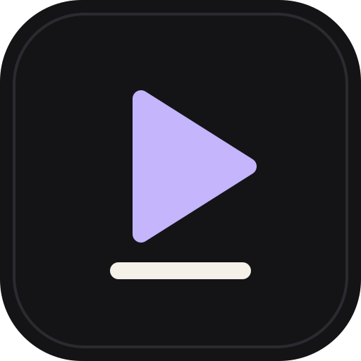
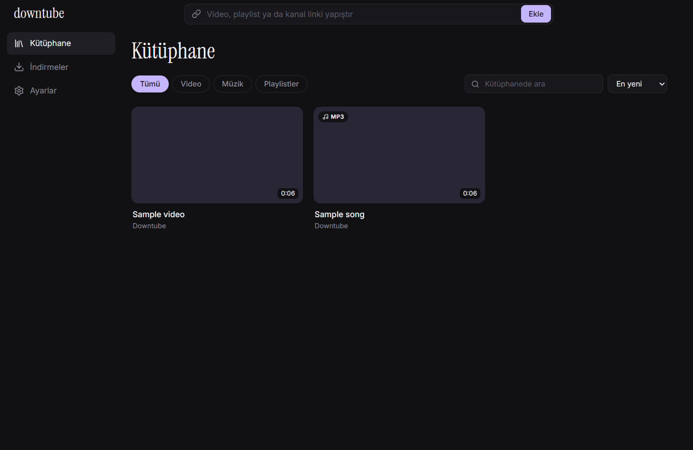

<p align="center"></p>

<h1 align="center">downtube</h1>

<p align="center">YouTube videolarını, müziklerini, playlistlerini ve kanallarını indirip internetsiz izle.</p>



## Özellikler

- **Video** — En iyi, 1080p, 720p ya da 480p; MP4 olarak kaydedilir.
- **Müzik** — Kapak ve etiketleri gömülü MP3.
- **Playlist ve kanallar** — Önce liste gelir, istediklerini seçersin; 100'er öğelik sayfalar.
- **Boyutu önceden gör** — İndirmeden önce dosya boyutu (playlist ve kanallarda tahmini) ve diskteki boş alan; yer yetmeyecekse uyarır.
- **Offline oynatıcı** — Altyazı, hız, resim içinde resim, tam ekran ve klavye kısayolları.
- **Müzik çubuğu** — Sayfalar arasında çalmaya devam eder; sıra, karışık çalma, tekrar ve Windows medya tuşları.
- **Kaldığın yerden devam** — Video ve şarkılar bıraktığın saniyeden başlar.
- **Pano algılama** — YouTube linki kopyaladığında indirmeyi önerir.
- **Gece ve Kağıt temaları**, Türkçe ve İngilizce arayüz.

## Kurulum

[Releases](../../releases) sayfasından `Downtube-Setup-x.y.z.exe` dosyasını indirip çalıştır. Kod imzası olmadığı için Windows SmartScreen "bilinmeyen yayıncı" uyarısı verebilir: **Ek bilgi → Yine de çalıştır**. Kurulum masaüstüne ve Başlat menüsüne bir Downtube kısayolu ekler.

İlk açılışta Downtube, indirme motorunu resmi kaynaklarından kurar ve SHA-256 ile doğrular:

| Bileşen | Kaynak |
|---|---|
| [yt-dlp](https://github.com/yt-dlp/yt-dlp) | GitHub releases |
| [Deno](https://github.com/denoland/deno) | GitHub releases (YouTube'un JavaScript doğrulamaları için gerekli) |
| [ffmpeg](https://github.com/yt-dlp/FFmpeg-Builds) | Sistemde varsa o kullanılır, yoksa yt-dlp'nin derlemesi indirilir |

yt-dlp günde en fazla bir kez, indirme yokken kendini günceller.

## Geliştirme

Gereksinimler: Windows 10/11, Node.js 24, (testler için) PATH'te ffmpeg.

```bash
npm install
npx install-electron # Electron 44 artık kurulumda ikilisini indirmez; npm run dev ve npm run test:e2e için gerekli
npm run dev          # geliştirme modu
npm test             # birim testleri
npm run test:live    # gerçek YouTube indirmesi (ağ gerekir)
npm run test:e2e     # Electron uçtan uca testi
npm run dist         # Windows kurulum dosyası
```

Mimari ve kararlar: [`docs/superpowers/specs/2026-10-09-downtube-design.md`](docs/superpowers/specs/2026-10-09-downtube-design.md).

## Yasal not

Downtube kişisel kullanım içindir. İndirdiğin içeriklerin telif haklarına ve [YouTube Hizmet Şartları](https://www.youtube.com/t/terms)'na uymak senin sorumluluğundadır.

---

## English

**downtube** downloads YouTube videos, music, playlists and channels and plays them offline.

- Videos as MP4 (Best/1080p/720p/480p), music as MP3 with cover art and tags.
- Playlists and channels are listed first so you pick what to download.
- The download size (estimated for playlists and channels) and your free disk space are shown before you start.
- Offline player with subtitles, speed control, picture-in-picture and keyboard shortcuts.
- A music bar that keeps playing across pages, with queue, shuffle, repeat and media keys.
- Resume where you left off, clipboard link detection, dark (Gece) and light (Kağıt) themes, Turkish and English UI.

Install it with `Downtube-Setup-x.y.z.exe` from [Releases](../../releases); the installer adds Desktop and Start menu shortcuts. On first launch Downtube installs yt-dlp, Deno and (if missing) ffmpeg from their official releases and verifies them with SHA-256. Downtube is for personal use; respect copyright and YouTube's Terms of Service.

License: [MIT](LICENSE)
